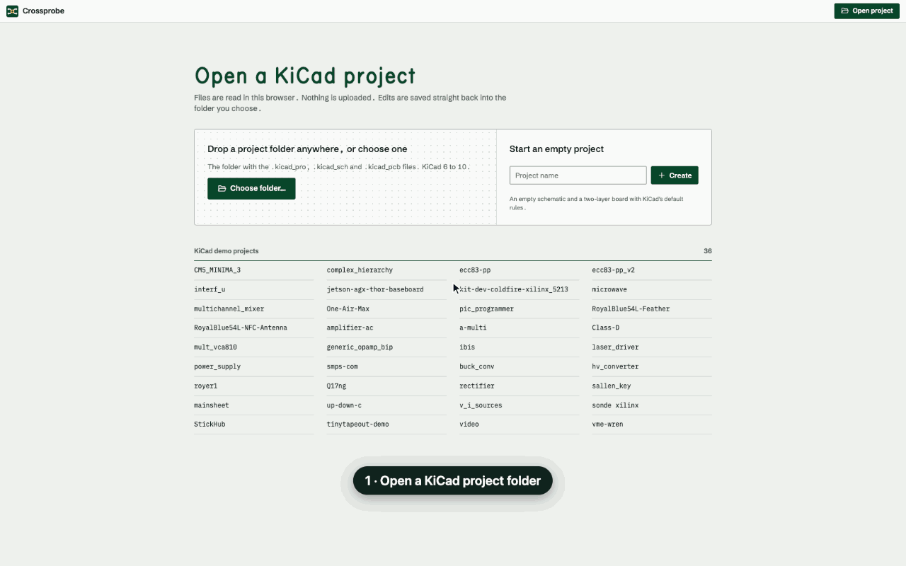

# Crossprobe

A KiCad editor that runs in the browser. Open a KiCad project folder, view and
edit its schematic and board, and save it back as KiCad files: unmodified files
are written back byte for byte, and edits produce minimal diffs. The goal is
parity with KiCad: its behaviour is reimplemented in TypeScript and checked against
what KiCad itself does with the same projects.

Website: <https://crossprobe.dev>



## What it does

- Schematic, PCB and 3D views, with cross-probing between them.
- Schematic editing: wires, labels, buses, hierarchical sheets, parts from KiCad's
  libraries, annotation, ERC.
- PCB editing: placement, interactive routing (45° tracks, vias, differential pairs,
  length tuning), zones, Update PCB from schematic, DRC, schematic ↔ board parity.
- Symbol and footprint editors; plotting; fabrication outputs (Gerber, drill, BOM,
  pick-and-place, IPC-2581, ODB++, STEP, GLB).
- [Design blocks](blocks/README.md) (reference circuits with cited checklists),
  [requirements](docs/requirements.md) and [compatibility](docs/compatibility.md)
  checks, and datasheet evidence pinned to parts.

What works and what doesn't yet, feature by feature: [KiCad parity](#kicad-parity).

## Run it

With Docker ([docs/docker.md](docs/docker.md)):

```sh
docker compose up --build
```

Then open <http://localhost:5173> in Chrome, Edge or another Chromium browser and
choose your project's folder. Files stay on your computer: the browser reads the
folder and saves into it.

Without Docker, with Node.js 20 or later (KiCad's libraries are read from a KiCad
installation, or from `KICAD_SYMBOLS`, `KICAD_FOOTPRINTS` and `KICAD_DEMOS`):

```sh
npm ci
npm run dev         # the app at http://localhost:5173
```

## Develop

```sh
npm run build       # @crossprobe/kicad-sexpr and @crossprobe/kicad-model
npm run typecheck   # the app
npm test
```

| Path | What it is |
|---|---|
| [`packages/kicad-sexpr`](packages/kicad-sexpr) | Lossless parser and writer for every KiCad S-expression format, with KiCad-style editing helpers |
| [`packages/kicad-model`](packages/kicad-model) | The design model: schematic hierarchy and nets as KiCad sees them, the board, ERC, DRC, parity, editing, fabrication outputs, design blocks |
| [`apps/web`](apps/web) | The browser app |
| [`apps/web/src/extensions`](apps/web/src/extensions/api.ts) | The editor's extension points: inspector tabs, places to open and keep projects, sections of the Review tab |

Many tests compare results with KiCad's own on its demo projects, and skip when
KiCad or the demos are missing. KiCad and its libraries are found in the usual
places on macOS and Linux ([test-setup.ts](test-setup.ts)). The demos are not
part of every installer: they are the `demos` folder of KiCad's source, so point
the tests at a copy.

| Variable | What it points at |
|---|---|
| `KICAD_CLI` | KiCad's command-line program, when it is not in the usual place |
| `KICAD_DEMOS` | KiCad's demo projects |
| `KICAD_CORPUS` | A folder of other projects to compare on, in place of the demos (the file round trip takes several, colon-separated) |
| `KICAD_QA` | The `qa/data` folder of KiCad's source, for the netlist edge cases |

The tests that compare with KiCad don't run on GitHub (the runner has no
KiCad): run `npm test` with the demos before changing the model, the checks or
the exports. The browser scripts in `scripts/e2e-*.mjs` drive the app end to
end ([docs/end-to-end.md](docs/end-to-end.md)).

Commit messages follow [Conventional Commits](https://www.conventionalcommits.org)
(`fix:`, `feat:`, `feat!:` for a breaking change, and `docs:`, `test:`, `ci:`
for the rest). Releases are made from them: each push to `main` updates a release
pull request with the next version and the changelog, and merging it tags
`vX.Y.Z` and publishes the release
([release.yml](.github/workflows/release.yml)).

## KiCad parity

What a KiCad user can expect, compared with KiCad 9 and 10. The comparisons were
last run with KiCad 10.0.5. Update this list in the same change that adds or
completes a feature.

- **Works**: implemented, and checked against KiCad (a test or an end-to-end
  script compares the result with what KiCad gives for the same project).
- **Partly**: usable, with the limits given.
- **View only**: existing items are read, drawn, plotted and kept on save, but
  can't be made or changed here.
- **No**: not there. Unless noted, such items in an existing file are left
  untouched when you save, but are not shown.

### Files and projects

| Feature | Status | Notes |
|---|---|---|
| `.kicad_sch`, `.kicad_pcb` read and write | Works | Unchanged files are written back byte for byte; edits change only the lines they touch |
| Project symbol and footprint libraries (`.kicad_sym`, `.pretty`) | Works | Derived symbols are resolved |
| `.kicad_pro` | Partly | Net classes, design-rule minimums, severities, DRC exclusions and the pin conflict map are read and written; other settings are kept, with no way to edit them |
| New project, open a folder, save in place | Works | Saving in place needs a Chromium browser; others download the changed files. New files are written as KiCad 10 |
| Unsaved changes survive a reload | Works | |
| File versions before KiCad 9 | Partly | KiCad 6, 7 and 8 files are read: every file in KiCad's own test data is written back byte for byte, and netlists (of annotated designs) and IPC-D-356 files match KiCad's on them. Editing and saving such files is untested |
| KiCad's installed libraries (symbols, footprints, 3D models) | Partly | Served by the dev server or the Docker image; your own path variables are not resolved |
| Library tables | Partly | Project tables with `${KIPRJMOD}` entries; no table editor |
| Custom design rules (`.kicad_dru`) | Partly | Read and applied for some constraints (see PCB editor); no editor |
| Text variables (`${REVISION}`, `${REFERENCE}`, project variables) | Partly | In the schematic, shown, plotted and netlisted as KiCad resolves them: the title block, sheet and project variables, a part's own fields, another part's (`${R1:VALUE}`). Not the net, pin and simulation variables (`${NET_NAME(1)}`, `${OP}`); on the board they are shown as written. No editor for project variables |
| Custom drawing sheets (`.kicad_wks`) | No | A default frame is drawn |
| Legacy formats (`.sch`, `.brd`, `.lib`), importers (Eagle, Altium, EasyEDA, …) | No | |
| Design variants, jobsets, embedded files, project templates and archives | No | |

### Schematic editor

| Feature | Status | Notes |
|---|---|---|
| Connectivity and net names as KiCad computes them | Works | Compared pin for pin and name for name with KiCad's netlist: hierarchy, buses, jumper pins and stacked pin numbers included |
| Wires, junctions, no-connects | Works | Dragging keeps connections |
| Buses, bus entries, vector buses | Works | Bus aliases are read; they can't be defined here |
| Local and hierarchical labels | Works | |
| Global labels | Works | With the shape (input, output, …) |
| Power symbols, PWR_FLAG | Works | |
| Hierarchical sheets and sheet pins | Works | A selected sheet symbol is renamed, given a page number, and its pins synchronised with the labels inside. Its file can't be changed, and its pins can't be moved or deleted one by one |
| Placing symbols from project and KiCad libraries | Works | |
| Multi-unit symbols | Works | |
| Body styles (De Morgan) | Works | Made in the symbol editor; a placed symbol is switched in the inspector |
| Alternate pin functions | Works | Defined per pin in the symbol editor (name, type, shape); a placed symbol's pin is switched in the inspector, and the sheet, ERC and netlist follow |
| Move, rotate, mirror, delete, box select, copy, paste, duplicate | Works | Its own clipboard: not the system's, not between projects |
| Undo and redo | Works | |
| Fields, and the symbol fields table | Works | A field on the sheet is dragged, turned (R) and edited (double-click) on its own, and shown or hidden in the inspector. No font or justification settings, no autoplace; no BOM presets |
| DNP, exclude from BOM, exclude from board, exclude from simulation | Works | A part not populated is crossed out, on the sheet and in plots |
| Annotation | Works | The whole schematic or one sheet; new parts only or all, by X or Y; from a start number or the sheet number × 100 or × 1000; clear annotation. No selection scope |
| Footprint assignment | Works | Filtered by the symbol's footprint filters and pin count |
| Text, text boxes, lines, rectangles, circles, arcs | Works | No font or style settings; beziers are view only |
| Images | View only | |
| Intersheet references | Works | The pages a global label is on, as KiCad lists them (own page, short form, prefix and suffix), switched on in Page settings; drawn where KiCad places them, not movable |
| Net class directives, rule areas | Works | Placed on wires and buses, or on a rule area's outline for everything inside; a label's Netclass field counts too. Nets get KiCad's classes, combined ones included ("A,Default"), and the project file keeps them as KiCad does. Only the Netclass field: no component classes |
| Tables, hyperlinks | No | |
| Find and replace | Works | Ctrl+F: texts, text boxes, labels, sheet names and pins, and fields, on every sheet; match case, whole words, wildcards, references, hidden fields. Replace all is one undo step. Not pin names or numbers |
| Cross-probing and net highlighting | Works | Between schematic, board and 3D |
| ERC | Partly | 29 checks, at least 98% agreement with KiCad on its demos, and 89% of KiCad's findings on the edge cases in its own test data: pin conflicts (with the project's pin map), undriven and unconnected pins, no-connect, label, wire, off-grid, multiple net names, similar labels, duplicate references, sheet pins and hierarchical labels without a partner, unplaced units (and their input, supply and bidirectional pins), units with different footprints, duplicate sheet names, a local label named like a global one, unresolved text variables (in texts), a global label that appears once, labels and power nets that differ only in case, field names with spaces around them. Undefined net classes. Not checked: units of one part on different nets, bus conflicts, ground pins off the ground net, library and footprint link issues. Severities are read from the project; no exclusions |
| Netlist export | Works | KiCad's format (`.net`): the same parts, fields, nets and pins as `kicad-cli` writes on its demos. A net in several classes names the first. Not the OrcadPCB2, CadStar, Allegro, PADS, SPICE or XML formats |
| SPICE simulation | No | |
| Design blocks | Partly | Inserts the blocks in `blocks/`; can't save a selection as a block |
| Page settings and title block | Works | |
| Plot to SVG and PDF | Works | PDF through the browser's print dialog. No PostScript, DXF or HPGL |

### PCB editor

| Feature | Status | Notes |
|---|---|---|
| Place, move, rotate, flip, lock footprints | Works | Compared with KiCad's result for the same move |
| Update PCB from schematic, update schematic from PCB | Works | |
| Update footprints from the library | Works | |
| Schematic ↔ board parity, ratsnest | Works | A few zone-to-pad cases over-report unconnected items |
| Copper layer count, design-rule minimums, net classes | Works | With presets for KiCad's defaults and JLCPCB. A net in several classes (by pattern or from the schematic) combines them by priority, with Default filling what they leave unset, as KiCad 10 does |
| Stackup | Partly | Read and used; written only from the presets; no editor |
| Custom rules | Partly | `clearance`, `hole_size`, `annular_width`, `track_width`, `via_diameter`, with the common condition functions. Not: length, skew, differential pair gap, edge, silk and courtyard clearance, `disallow` |
| Interactive routing with 45° tracks | Works | Posture, width, via and layer change while routing |
| Router modes | Partly | Highlight collisions and walkaround work; shove moves up to three tracks, along the grid |
| Arc tracks | View only | Drawn, measured and plotted; can't be routed |
| Dragging tracks | Partly | Track ends, and tracks follow a moved footprint; no segment drag |
| Vias: through, blind, buried, micro | Works | No tenting or via-in-pad options |
| Differential pairs | Partly | Coupled routing with paired vias; they don't shove |
| Length tuning | Partly | Single-track meanders to a target, and matching a pair; not saved as KiCad tuning patterns |
| Teardrops | Partly | Straight-edged; all or none |
| Zones: draw, fill, refill | Works | Priorities, thermal reliefs, island removal and keepouts are honoured; fills compared with KiCad's by area and by its DRC |
| Zone properties | Partly | Net, layer, pad connection, name, priority, clearance, minimum width, thermal gap and spoke width, island removal: edited in the properties panel, honoured by the fill, and read back by KiCad as set. Multi-layer zones keep their layer set; no hatched fill, corner smoothing or per-layer properties. Hatched fills are kept, not refilled |
| Point editing of zones and shapes | Works | KiCad's handles on a selected zone, polygon, line, rectangle, circle or arc: corners, and edge middles that move an edge with its corners sliding along the neighbours; Add Corner and Remove Corner from the right-click menu. Outlines KiCad reads back as edited. Only a zone's first outline; no chamfer or fillet of corners |
| Keepout and rule areas | View only | Honoured by the fill, the DRC and custom rules |
| Board outline | Works | Rectangle, rounded rectangle, polygon, mounting holes |
| Graphics on other layers | View only | Movable; no drawing tools beyond the outline |
| Text | Partly | Silkscreen text can be placed and edited; knockout and TrueType text are view only |
| Dimensions | Partly | Aligned and orthogonal can be placed; radial, leader and centre are view only |
| Groups | Works | Group (Ctrl+G) and Ungroup (Ctrl+Shift+G), nested groups; a click selects a part's whole group, which moves, locks (L) and deletes together; deleted items leave their groups and empty groups go. KiCad reads the groups back as made. Copies (duplicate, paste, array) are not grouped; no entering a group to edit one part |
| Text boxes | Works | Drawn with the text box tool (two corners, then the text), shown, plotted and wrapped as KiCad wraps them; turned, moved, aligned, and their text, size and layer edited. Plots match kicad-cli's (wrapping, every justification, turned, mirrored, with and without a border). Stroke font only; no knockout, margin or border editing |
| Images, tables | No | |
| DRC | Partly | Clearance and shorts; copper to edge and to hole; hole size, annular width, hole to hole; track width, via size; dangling tracks and vias; courtyard overlap, holes in another part's courtyard; overlapping zones of one net and priority; footprint type against its pads; starved thermals; silkscreen overlap and clipping; solder mask bridges; text size; keepouts (tracks and vias). Not checked: connection width, copper slivers, missing courtyards, footprint library mismatches, length and skew, invalid outline. Severities are read from the project |
| DRC exclusions | Partly | KiCad honours ours only where the marker position equals its own |
| Net inspector | Works | Lengths per layer, vias, CSV. Lengths follow KiCad 10.0; KiCad 10.0.5 measures a few nets up to 0.2 mm shorter |
| Selection filter, layer visibility, flip view, measure tool | Works | No layer colours, presets or net colours |
| Copy, paste, duplicate | Works | Its own clipboard |
| Cleanup tracks and vias, geographic reannotation, board statistics | Works | |
| Pad properties | Partly | Size, shape, drill and net; not margins or zone connection |
| Logo footprint from a bitmap | Works | No smoothing |
| Align and distribute | Works | KiCad's ten commands, from the right-click menu: by bounding boxes (footprints without their text), locked items stay put and set the target, else the item under the cursor. Boxes compared with KiCad's on its demos; TrueType text is measured by its outlines |
| Arrays | Works | KiCad's Create Array (Ctrl+T): grids with offsets, stagger and fill order, circles with or without turning the items; copies get the next free references after their own, or keep them; or the selection itself is laid out. Copies compared with KiCad's pcbnew. No pad numbering (footprint editor) |
| Position relative | Works | KiCad's Position Relative To (Shift+P): the selection's top-left footprint to an item or point picked on the board, or the grid origin, plus an offset in x/y or polar; locked items stay. Positions compared with KiCad's. No local origin |
| DXF and SVG import, footprint wizard, component classes, repeated layout | No | |
| Python scripting, action plugins, the IPC API | No | |

### Symbol and footprint editors

| Feature | Status | Notes |
|---|---|---|
| Symbols: pins (all electrical types and shapes), pin table, body graphics, fields | Works | Beziers are view only |
| Symbols: units, unit names, body styles, jumper pin groups, power symbols | Works | |
| Symbols: update placed symbols from the library | Works | Wires on moved pins are not re-attached |
| Symbols: alternate pin functions | Works | Name, electrical type and shape per alternate |
| Symbols: derived symbols, import and export | No | Derived symbols in existing libraries are read |
| Footprints: pads singly, in rows and in grids; move, rotate, mirror, renumber | Works | Compared with KiCad's result |
| Footprints: pad types and shapes | Partly | SMD, through-hole and NPTH; rectangle, rounded rectangle, circle, oval, custom polygon. No trapezoid, chamfered or slotted pads |
| Footprints: mask and paste overrides, paste windows | Works | |
| Footprints: graphics on silkscreen, fab and courtyard; automatic courtyard | Works | No free text, fields only |
| Footprints: 3D model with offset, rotation, scale and a preview | Works | |
| Footprints: update placed footprints from the library | Works | |
| Symbol and footprint checks | Partly | Their own lists, not KiCad's checkers |
| Editing KiCad's own libraries, library management | No | A library part is copied into the project's library first |

### 3D viewer

| Feature | Status | Notes |
|---|---|---|
| Board with holes, copper, mask and silkscreen; STEP and VRML models | Works | Models placed as in KiCad's viewer; a missing model is shown as a box |
| Orbit, pan, zoom, view presets; click a part to select it | Works | |
| Layer visibility, colours, appearance presets | No | Parts can be hidden |
| Raytracing, render to an image | No | |

### Outputs

| Feature | Status | Notes |
|---|---|---|
| Gerber X2 | Works | Each layer within 1% of KiCad's plot by area. Fixed options; no X1 |
| Excellon drill files | Works | PTH, NPTH and a file per blind or buried span. No Gerber drill files, map or report |
| Gerber job file | Works | |
| Pick-and-place (CSV) | Works | Identical to KiCad's |
| BOM (CSV) | Partly | Grouped by value, footprint and part number; no presets |
| IPC-2581, ODB++ | Works | Compared with KiCad's by what CAM tools read |
| IPC-D-356 | Works | Byte-identical to KiCad's on its demo boards |
| STEP | Works | Volume within 0.1% of KiCad's; holes and arcs are polygons |
| GLB, STL, PLY | Works | |
| Board and schematic plots: SVG, PDF | Works | PDF through the browser's print dialog; few plot options |
| DXF, PostScript, HPGL, VRML, GenCAD, 3D PDF | No | |

### KiCad's other tools

| Feature | Status | Notes |
|---|---|---|
| Calculator | Partly | Track current and microstrip impedance, in Board setup |
| Gerber viewer, drawing sheet editor, plugin and content manager | No | |
| A command line like `kicad-cli` | No | `@crossprobe/kicad-model` can be used as a library from Node |
| Preferences, hotkey editor | No | Shortcuts follow KiCad's defaults |

### Not in KiCad

- An autorouter: single connections, and "Route all" with fan-out and stitching to
  pours.
- ERC, DRC and parity run after every edit; one-click fixes for common ERC findings.
- [Design blocks](blocks/README.md) with cited checklists, [requirements](docs/requirements.md)
  and [compatibility](docs/compatibility.md) checks, and datasheet evidence pinned to
  parts.
- Land patterns generated from datasheet dimensions.
- A pre-flight check before fabrication files are made, with JLCPCB presets and files.

## Licence

Apache-2.0 (see [LICENSE](LICENSE)). Third-party material keeps its own licence;
see [NOTICE](NOTICE). No KiCad source code is included: KiCad's behaviour is
reimplemented and compared with KiCad's results, never copied.
